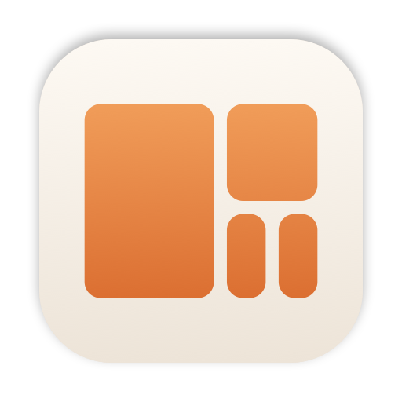
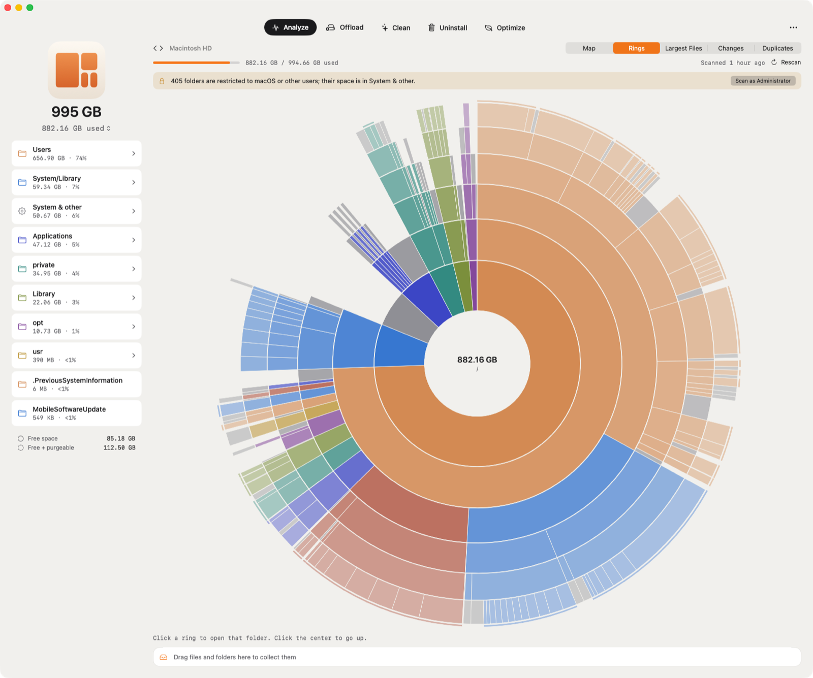
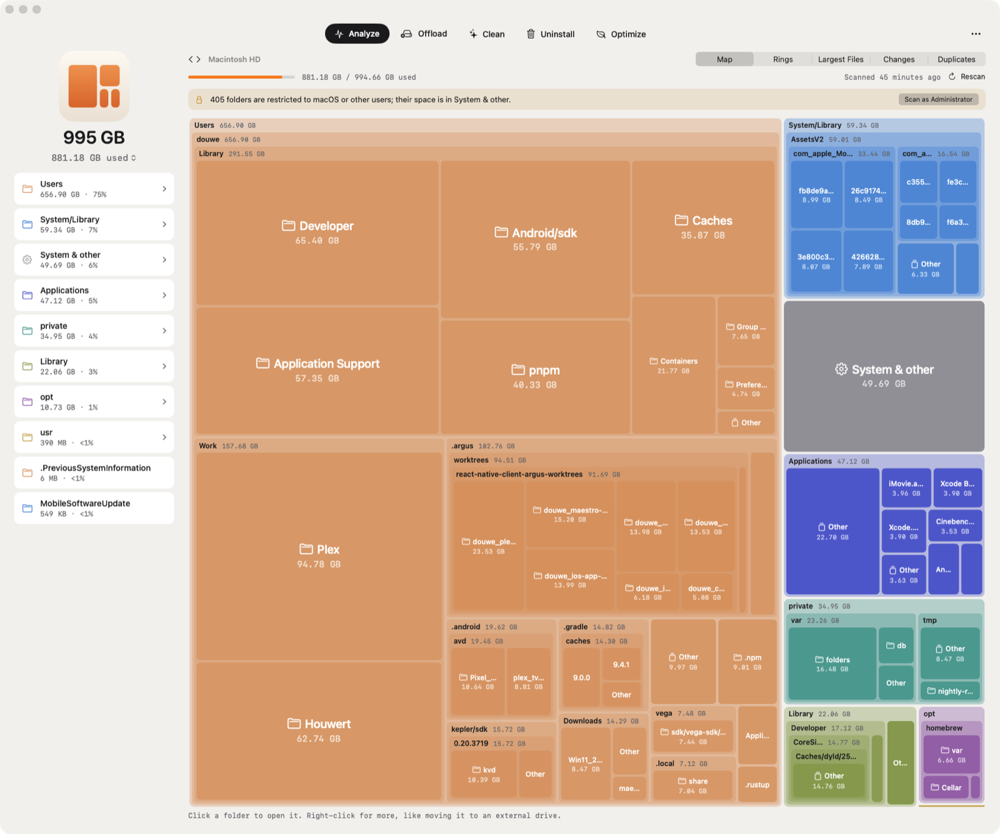

<p align="center">
  <picture>
    <source media="(prefers-color-scheme: dark)" srcset="docs/images/icon-dark.png">
    
  </picture>
</p>

<h1 align="center">Charon</h1>

<p align="center">
  <strong>See where your disk space goes. Then get it back.</strong><br>
  A native macOS disk analyzer that finds what's filling your Mac, cleans what apps rebuild on their own,<br>
  and moves heavy folders to an external drive without breaking a single path.
</p>

<p align="center">
  
</p>

## Why Charon

Your disk is always full, and the usual answer (delete something) is the wrong one half the time. Charon shows you exactly what's taking the space, tells you what's safe to clear, and for the things you want to keep but don't need on your internal drive, moves them to an external one and leaves a link behind, so every app still finds them.

## Analyze

Scan your startup disk, any external disk, or any folder, and see it in the way that suits you.

- **Map**: a nested treemap that shows three levels at once and looks past folders that hold nearly everything, so you see inside your home folder straight away.
- **Rings**: a sunburst with six levels, rings thinning outward, and a rim wherever there's more inside. Hover a ring and the sidebar shows what's in it.
- **Largest Files**, filterable by how long since you last opened them.
- **Changes**: what grew since your previous scan, narrowed down to the folder that explains it.
- **Duplicates**: identical large files, checked by full SHA-256, leaving APFS clones out.
- **System & other**, explained: the macOS volume, VM and recovery, purgeable space and restricted folders.
- **Scan as Administrator** to measure folders owned by macOS and other users. It's a one-off scan behind the standard password prompt, with nothing left installed.

Scans are fast (`getattrlistbulk` on every core), live while they run, and remembered between launches. Drag anything to the Collector at the bottom, review the total, and move it to the Trash.

<p align="center">
  
</p>

## Offload

Move a folder to an external drive and leave a symlink in its place. Charon copies it, verifies every byte with SHA-256, and only then swaps in the link. Every step is journaled, so an interrupted move finishes or rolls back and never loses data. It refuses system and protected locations, warns when an app has files open, tracks every offloaded folder, tells you when its drive is disconnected, and moves it back when you want it home. It also suggests the largest folders that are safe to move.

## Clean, Uninstall, Optimize

- **Clean**: Xcode DerivedData, simulator and package-manager caches, app caches, logs, Mail attachments, old installers, and git worktrees whose work is already merged. Each is marked as rebuilt automatically or worth reviewing first. Everything goes to the Trash, never straight to deletion.
- **Uninstall**: your apps by size and last use, with the leftovers they scattered through `~/Library`, matched by bundle ID.
- **Optimize**: every launch agent and daemon, flagging the ones whose app is gone.

## Menu bar monitor

A small login item that shows free space in the menu bar, warns before your disk fills up, tells you when a drive with offloaded folders disconnects, and shows which folders grew most since your last scan; click one to open it in Charon, where you can look inside or collect it for the Trash. It's on by default; turn it off in Settings.

## Keyboard

| Key | Action |
|---|---|
| ↑ ↓ | Move the selection |
| → or Return | Open the selected folder |
| ← or ⌘↑ | Enclosing folder |
| Space | Quick Look |
| Delete | Add to Collector |
| ⌘[ ⌘], mouse back/forward buttons, three-finger swipe | Back, Forward |
| ⌘R | Rescan |
| ⌘1–⌘5 | Tabs |

## Requirements

- macOS 26.2 or later
- Full Disk Access for complete scans (System Settings → Privacy & Security). Charon walks you through it on first launch.

## Building

Needs Xcode 27 or later. Open `app/Charon/Charon.xcodeproj` and build the `Charon` scheme, or:

```sh
cd app/Charon
xcodebuild -project Charon.xcodeproj -scheme Charon -derivedDataPath build -destination 'platform=macOS,arch=arm64' build
open build/Build/Products/Debug/Charon.app
```

The engine (`CharonKit`) has no UI dependencies and its tests run headlessly: `cd app/Charon/Packages/CharonKit && swift test`.

## Docs

- [Architecture](docs/architecture.md)
- [Offload](docs/offload.md)
- [Scan as Administrator](docs/admin-scan.md)
- [Clean](docs/clean.md)
- [Uninstall](docs/uninstall.md)
- [Optimize](docs/optimize.md)
- [Settings](docs/settings.md)
